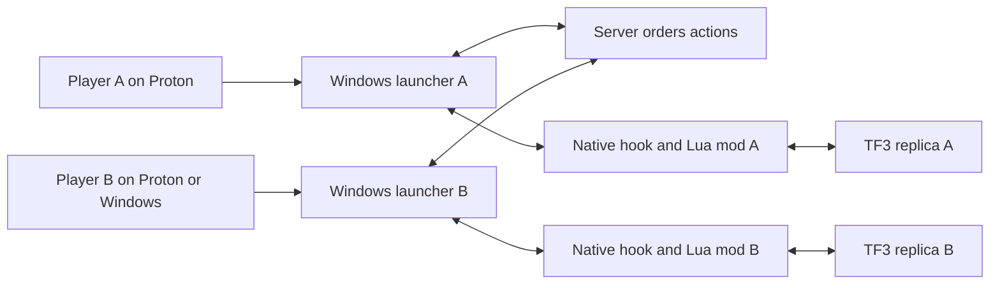

# Transport Fever 3 competitive multiplayer feasibility

Assessed 11 October 2026, Australia Sydney. Target: people running separate transport companies on the same map, using the Windows game through Proton.

**Competitive multiplayer is technically credible, and extending TPF3-MP is the strongest starting point.** The game has real player ownership and account primitives, and two open source projects already implement multiplayer. The remaining investment is proving reliable play under your Proton environment and closing gaps in company mechanics, synchronization and supported actions. This assessment covers source and published evidence; neither mod has been run here.

## Existing projects and the recommended base

| Project | Relevant implementation | Evidence and limitations | Role |
| --- | --- | --- | --- |
| [TPF3-MP](https://github.com/Juliansgith/Transport-Fever-3-Multiplayer-Mod) | Rust launcher, relay server, native game hooks and Lua mod; separate companies, ordered actions, world checks and save recovery | Published v1.3.0 targets Windows game build 40420. Authors report a local two-game shared-save and line-rename test with nine matching checkpoints through step 2300. Broader competitive play and our Proton environment remain to be validated. | Recommended base |
| [MPFever](https://github.com/dkdknight/MPFever) | C# launcher, TCP relay, Lua file bridge and native Windows DLL; host-save recovery | Latest published release observed was 0.2.10. Inspected main contains 0.3.4 experimental company work, including separate loans, contracts and station fees. Its changelog still warns of company-mode bugs. | Reference for selected company fixes |

TPF3-MP has deliberate Proton accommodations: Steam-directory discovery through `STEAM_COMPAT_CLIENT_INSTALL_PATH`, explicit `--game-exe` selection, and a plain UDP fallback for socket options Wine rejects. These changes are present in v1.3.0. The integration record says no fresh Proton game session was run for that integration, so compatibility remains a test gate. [Player guide](https://github.com/Juliansgith/Transport-Fever-3-Multiplayer-Mod/blob/v1.3.0/docs/PLAYING.md), [Steam discovery](https://github.com/Juliansgith/Transport-Fever-3-Multiplayer-Mod/blob/v1.3.0/crates/tpf3mp-agent/src/steam.rs), [integration evidence](https://github.com/Juliansgith/Transport-Fever-3-Multiplayer-Mod/blob/538733611cc5e4c8ea30d48513d5b0df761db05a/investigation/PR_REVIEW_2026-10-02.md).

Both projects use MIT licences, allowing modification and redistribution with their copyright and licence notices retained. Preserve attribution for reused code and check asset and dependency licences when packaging a fork. [TPF3-MP licence](https://github.com/Juliansgith/Transport-Fever-3-Multiplayer-Mod/blob/538733611cc5e4c8ea30d48513d5b0df761db05a/LICENSE), [MPFever licence](https://github.com/dkdknight/MPFever/blob/3f0abe0bd1f4051060c688019914786c3511368d/LICENSE).

Start from the released TPF3-MP v1.3.0 baseline and review subsequent fixes individually. A narrow fork would keep game-update maintenance manageable. MPFever is useful for comparisons, but combining both complete synchronization systems would increase uncertainty. Its newer company source should not be confused with its published download. [TPF3-MP release](https://github.com/Juliansgith/Transport-Fever-3-Multiplayer-Mod/releases/tag/v1.3.0), [MPFever release](https://github.com/dkdknight/MPFever/releases/tag/0.2.10), [MPFever company changes](https://github.com/dkdknight/MPFever/blob/3f0abe0bd1f4051060c688019914786c3511368d/docs/CHANGELOG.txt).

## What the game supports

The official command API exposes player creation, ownership transfer, player-owned lines and purchases. The engine exposes player accounts, ownership filters and financial queries by player entity. These are substantial foundations for competing companies. [Command reference](https://wiki.transportfever3.com/script-doc/api/cmd.html), [engine reference](https://wiki.transportfever3.com/script-doc/api/engine.html), [finance reference](https://wiki.transportfever3.com/script-doc/api/engine/util.html).

The installed game supplies stronger implementation evidence: a campaign helper creates an `aiPlayer` and transfers vehicles, lines, stations and constructions to it. However, the company update script only services `getPlayer()`; iteration across all player entities is commented out. The loan script also keeps one loan table and repeatedly books against the current player. These mechanics need company-aware routing, and the usual interface needs a distinct company context for each person.

Local evidence paths, relative to `/home/reedme/.local/share/Steam/steamapps/common/Transport Fever 3`:

| Finding | Source |
| --- | --- |
| Add player, change ownership, create line, buy vehicle | `api/tealdef/api/cmd.d.tl`, lines 685–693, 760–767 and 884–892 |
| Native ownership and account fields | `api/tealdef/api/engine.d.tl`, lines 21–29 and 854–859 |
| Shipped second-player example | `base/content/mission.zip`, entry `mission/tasks/transfer_ownership/transfer_ownership_util.tl`, lines 4–48 |
| Company update services one current player | `base/content/game_mechanics.zip`, entry `game_mechanics/company/company.script.tl`, lines 274–285 |
| Loan state and bookings assume one player | Same archive, entry `game_mechanics/finance/loan.script.tl`, lines 37–52, 101–103, 119–136 and 171–175 |

The public API provides command execution, readable simulation state and whole-save load/save. It does not establish a universal command interception interface, deterministic simulation contract or complete live-state replication API. Its engine interface is read-only, and the debug component-exchange helper is limited to named component types. A Lua-only approach to unrestricted real-time multiplayer is therefore a poor initial bet. [Engine access](https://wiki.transportfever3.com/script-doc/api/engine.html), [command and debug APIs](https://wiki.transportfever3.com/script-doc/api/cmd.html), [save APIs](https://wiki.transportfever3.com/script-doc/app.html).

Some official scripting guides explicitly remain unadapted for TF3. Installed source and generated API definitions should take precedence over inherited guide examples. [Game Scripts guide](https://wiki.transportfever3.com/doku.php?id=modding%3Ascripting%3Agamescripts).

## How the reusable architecture works

TPF3-MP uses a server to order actions. Every player's game applies the same actions at assigned simulation steps and runs its own replica of the world. Native hooks intercept game commands and control advancement; the Lua mod maps portable actions to game operations. Checkpoints detect some differences, and shared saves support recovery. The relay does not run the entire TF3 simulation. [Architecture](https://github.com/Juliansgith/Transport-Fever-3-Multiplayer-Mod/blob/538733611cc5e4c8ea30d48513d5b0df761db05a/docs/ARCHITECTURE.md).

This makes existing simulation-order fixes especially valuable. Matching input alone does not ensure identical vehicle routing, entity allocation or industry growth. TPF3-MP already contains native ordering patches and investigations of these failures. Its inspected main also discloses an unexplained guest hang and industry-spawn divergence; longer sessions remain a material acceptance gate. [Ordering implementation](https://github.com/Juliansgith/Transport-Fever-3-Multiplayer-Mod/blob/538733611cc5e4c8ea30d48513d5b0df761db05a/crates/tpf3mp-hook/src/order.rs), [current stability notes](https://github.com/Juliansgith/Transport-Fever-3-Multiplayer-Mod/blob/538733611cc5e4c8ea30d48513d5b0df761db05a/docs/RELEASE_NOTES_1.3.1.md).

## Proton implementation path

Run the **Windows launcher and Windows TF3 executable within the same Steam Proton runtime and prefix**, letting the multiplayer launcher start the game. This retains the project's existing Windows hook and process-loading approach. It is a proposed test configuration, not a verified setup.

The launcher creates the Windows game suspended, loads its hook DLL, waits for readiness and resumes it. Validate that process sequence, Steam access and shared memory under the chosen Proton version. Launching a long-lived helper first and then launching the game normally can conflict with Proton's waiting for the existing Wine server to exit. Valve documents using the app runtime to launch another binary. [Injector source](https://github.com/Juliansgith/Transport-Fever-3-Multiplayer-Mod/blob/538733611cc5e4c8ea30d48513d5b0df761db05a/crates/tpf3mp-launch/src/windows.rs), [Valve runtime documentation](https://github.com/ValveSoftware/Proton/blob/proton_11.0/docs/DEBUGGING-LINUX.md).

The local Steam installation inspected has AppID 3493540 and Steam BuildID 25754343, but contains a Linux ELF executable and no Windows EXE. Its compatibility directory is empty. Locate the actual Windows installation and Proton context used for play before testing; no Steam settings or depots were changed. The installed game’s current internal build number remains unverified. Steam BuildID 25754343 must not be compared directly with game build 40420.

## Competitive features to validate or extend

| Area | Required behavior |
| --- | --- |
| Company identity | Each person founds or joins the intended company, and keeps it through saves and reconnects. Existing TPF3-MP starts players in the original company; founding separate companies is manual. |
| Finances | Purchases, maintenance, income, loans and contracts affect the correct company on every peer. |
| Asset permissions | A player cannot edit or demolish a rival's protected assets. Shared roads, tracks and stations follow explicit access rules. |
| Shared demand | Two companies serve the same towns or industries; both clients agree on passengers, cargo, revenue and network effects. |
| Company progression | Permits, headquarters, unlocks and perks have deliberate per-company or shared rules. |
| Recovery | Rejoining or resynchronizing preserves every company's assets, accounts, loans and identity. |

TPF3-MP has company implementations and permissions, but some actions remain gated, including waypoints, bridge/tunnel window rebuilds, company perks and historic preservation. Terrain paint and asset brushes are also refused. Keep the initial scope inside enabled actions. [Company code](https://github.com/Juliansgith/Transport-Fever-3-Multiplayer-Mod/blob/538733611cc5e4c8ea30d48513d5b0df761db05a/mod/tpf3mp_1/content/scripts/tpf3mp/companies.lua), [acceptance defaults](https://github.com/Juliansgith/Transport-Fever-3-Multiplayer-Mod/blob/538733611cc5e4c8ea30d48513d5b0df761db05a/mod/tpf3mp_1/content/scripts/tpf3mp/acceptance.lua).

Initially target competition among trusted friends. The default server uses the game's native economy and an `AcceptAll` ruleset; server sequencing does not make the economy fully authoritative or establish cheat resistance. [Server rules](https://github.com/Juliansgith/Transport-Fever-3-Multiplayer-Mod/blob/538733611cc5e4c8ea30d48513d5b0df761db05a/crates/tpf3mp-server/src/ruleset.rs).

## First prototype and acceptance gates

Use a disposable small vanilla map, two companies, buses or trucks, and the same Windows game build and mod versions on both peers. Begin at normal speed, with host-controlled pause. Proposed acceptance targets below are not measured results.

| Gate | Pass condition |
| --- | --- |
| Proton launch | Record game/mod/Proton versions; launcher starts Windows TF3, hook reports supported build and readiness, and the multiplayer interface works. |
| Two-company play | Both people create a company, road connection, depot, stops, line and vehicle; ownership and account changes match across peers. Rival modification attempts are rejected. |
| Economic competition | Both serve shared demand; run at least 30 minutes with moving vehicles and agree on cargo/passenger outcomes, accounts and ownership without repeated automatic reloads. |
| Replay coverage | Exercise vehicle purchase/sale, line edits, demolition, pause/resume and loans. Every accepted action executes once on each peer; unsupported actions receive a clear refusal. |
| Recovery | Save, disconnect/rejoin and force one supported resynchronization; verify all companies, accounts, loans, assets and routes afterwards. |
| Network conditions | Repeat with realistic latency and a brief interruption, recording delays and recovery. If Windows peers are in scope, include a Proton-to-Windows session. |

If these pass, extend a small fork around concrete missing features: easier separate-company setup, clearer owner displays, competitive scoring and selected missing company actions. If launch fails, fix the Proton wrapper or helper first. If worlds keep diverging, prioritize simulation stability before adding gameplay features. A development estimate becomes meaningful once the unchanged upstream baseline has passed or produced reproducible failures.

## Evidence boundary

Source snapshots inspected: TPF3-MP `538733611cc5e4c8ea30d48513d5b0df761db05a`; MPFever `3f0abe0bd1f4051060c688019914786c3511368d`. Published Windows test results are the authors' reports, not reproduced results on this machine. This investigation made no runtime compatibility claim and installed no mod. Local source fingerprints and validation status are in [evidence.json](/home/reedme/Documents/ChatGPT/TransportFever3/evidence.json).
